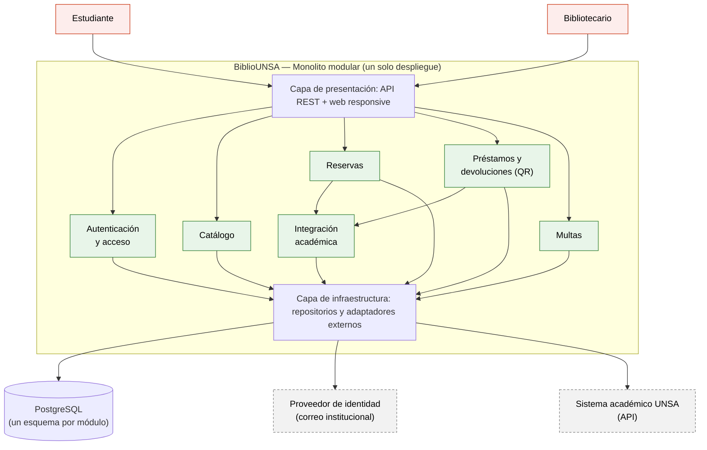
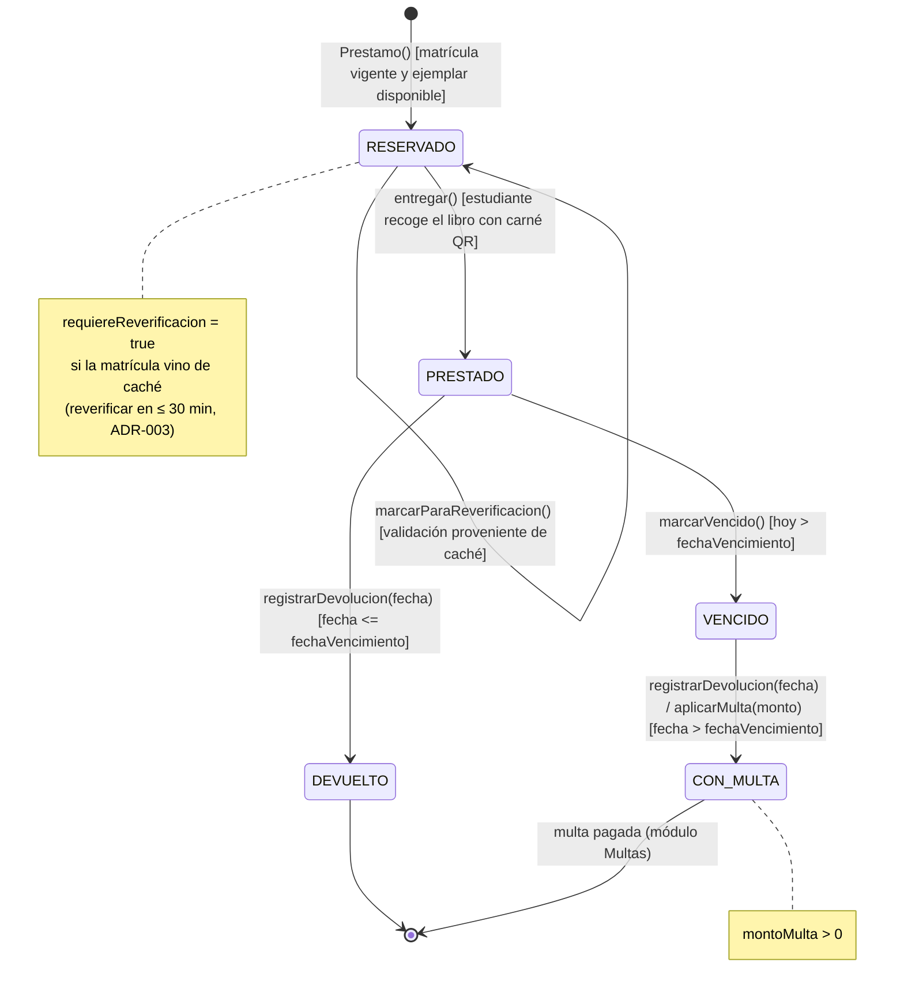
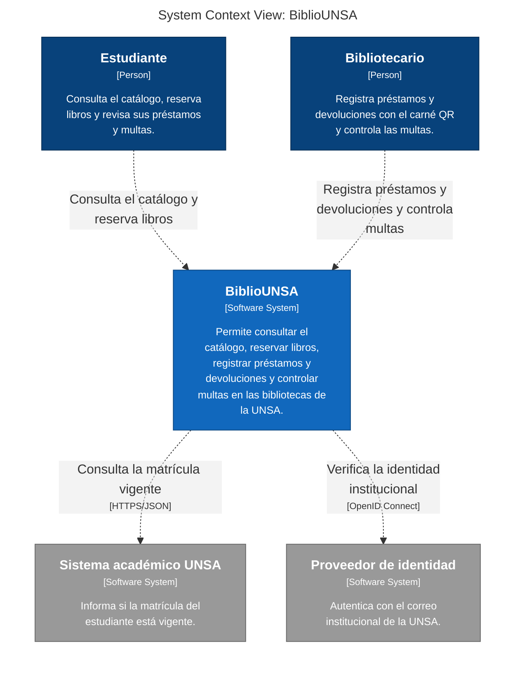

# BiblioUNSA — Laboratorio 04: Fundamentos de arquitectura de software
Construcción de Software · EPIS-UNSA · 2026-B · Grupo 04
 
## Integrantes
| Nombre | Rol en el laboratorio |
|--------|-----------------------|
| Valerio | Analista de drivers y responsable de la matriz de decisión |
| Mijael | Diagramador y redactor de ADR |
| Mauricio | Verificador de IA y responsable de documentación adicional |
 
## Caso
BiblioUNSA es una plataforma para el préstamo y la reserva de libros de las bibliotecas de la UNSA. Los estudiantes consultan el catálogo y reservan libros, y los bibliotecarios registran préstamos y devoluciones con el carné QR y controlan las multas. El sistema valida la matrícula vigente consultando al sistema académico solo mediante su API, sin acceder a su base de datos. El atributo de calidad crítico es la **seguridad e interoperabilidad**: únicamente debe entrar personal y estudiantes de la UNSA con su correo institucional.
 
## Arquitectura elegida
Monolito modular: un solo despliegue, con módulos separados y la integración académica aislada en un adaptador.



## Decisiones arquitectónicas
- [ADR-001: Estilo arquitectónico](docs/architecture/adr/001-estilo-arquitectonico.md)
- [ADR-002: Autenticación](docs/architecture/adr/002-autenticacion.md)
- [ADR-003: Integración Académica](docs/architecture/adr/003-integracion-academica.md)

## Reflexión sobre el uso de la IA (5–8 líneas)
La IA (Claude) nos ayudó a generar alternativas de estilo, redactar el borrador de los drivers y escenarios de calidad, puntuar la matriz de decisión y escribir el código Mermaid del diagrama. También cometió errores: recomendó microservicios, que no encajan con el plazo de 1 mes, los 3 developers ni el presupuesto de un VPS, y afirmó sin evidencia que el sistema académico de la UNSA tiene una API REST pública y documentada. Además, propuso un proveedor de identidad OAuth/OIDC que aún no está confirmado. Aprendimos a contrastar cada recomendación con nuestras restricciones, a recalcular a mano los totales de la matriz, a validar el diagrama en mermaid.live y GitHub, y a confirmar con la oficina responsable cualquier afirmación sobre sistemas reales. Por eso aislamos la integración en un adaptador con caché. La IA propone, pero el equipo decide y verifica; todo quedó registrado en la [bitácora](docs/architecture/bitacora-ia.md).

## Diseño UML (Lab 05)
Diseño detallado de la historia **HU-03: reservar un libro validando la matrícula vigente**, escrito como código (PlantUML y Mermaid), coherente con el ADR-001 y el ADR-003. La IA propuso los diagramas y el equipo los revisó con las reglas de consistencia C1–C5; todo quedó en la [bitácora de IA del Lab 05](docs/design/bitacora-ia.md).

### Máquina de estados del préstamo
Cada transición se nombra con una operación de la clase `Prestamo` (regla C2) y los estados coinciden con la enumeración `EstadoPrestamo`.



### Diagramas y documentos
| Entregable | Fuente | Imagen |
|------------|--------|--------|
| E1 Historia de usuario | [historia.md](docs/design/historia.md) | — |
| E1 Diagrama de clases | [clases.puml](docs/design/clases.puml) | [PNG](docs/design/img/diagrama_clases.png) |
| E2 Diagrama de secuencia | [secuencia-reservar-libro.puml](docs/design/secuencia-reservar-libro.puml) | [PNG](docs/design/img/secuencia-reservar-libro.png) |
| E3 Máquina de estados | [estados-prestamo.mmd](docs/design/estados-prestamo.mmd) | [PNG](docs/design/img/estados-prestamo.png) |
| E4 Diagrama de actividades | [actividades-devolucion-multa.puml](docs/design/actividades-devolucion-multa.puml) | [PNG](docs/design/img/actividades-devolucion-multa.png) |
| E5 Diagrama de paquetes | [paquetes.puml](docs/design/paquetes.puml) | [PNG](docs/design/img/paquetes.png) |
| E6 Round-trip | [round-trip.md](docs/design/round-trip.md) · [dominio.py](src/reservas/dominio.py) | [PNG](docs/design/img/classes_reservas.png) |
| E7 Consistencia C1–C5 | [consistencia.md](docs/design/consistencia.md) | — |
| E7 Bitácora de IA (Lab 05) | [bitacora-ia.md](docs/design/bitacora-ia.md) | — |

## Arquitectura C4 (Lab 06)
Modelo C4 de BiblioUNSA escrito como código en **un solo archivo** ([`workspace.dsl`](docs/architecture/c4/workspace.dsl), Structurizr DSL) del que se derivan las cinco vistas. Es coherente con el [ADR-001](docs/architecture/adr/001-estilo-arquitectonico.md) (contenedores y módulos), el [ADR-002](docs/architecture/adr/002-autenticacion.md), el [ADR-003](docs/architecture/adr/003-integracion-academica.md) y el [diagrama de paquetes](docs/design/paquetes.puml) del Lab 05 (las dependencias entre componentes coinciden exactamente y no hay ciclos). El nivel 4 (código) no se redibuja: es el [diagrama de clases](docs/design/clases.puml) del Lab 05.

### Contexto (nivel 1, exportado a Mermaid desde [`export/`](docs/architecture/c4/export/structurizr-Contexto.mmd))



### Vistas
| Vista | Imagen (C4-PlantUML) | Fuente exportada |
|-------|----------------------|------------------|
| Nivel 1 · Contexto | [PNG](docs/architecture/c4/img/structurizr-Contexto.png) | [puml](docs/architecture/c4/export/structurizr-Contexto.puml) · [mmd](docs/architecture/c4/export/structurizr-Contexto.mmd) |
| Nivel 2 · Contenedores | [PNG](docs/architecture/c4/img/structurizr-Contenedores.png) | [puml](docs/architecture/c4/export/structurizr-Contenedores.puml) · [mmd](docs/architecture/c4/export/structurizr-Contenedores.mmd) |
| Nivel 3 · Componentes de la API | [PNG](docs/architecture/c4/img/structurizr-Componentes.png) | [puml](docs/architecture/c4/export/structurizr-Componentes.puml) · [mmd](docs/architecture/c4/export/structurizr-Componentes.mmd) |
| Dinámica · Reservar un libro (HU-03) | [PNG](docs/architecture/c4/img/structurizr-ReservarLibro.png) | [puml](docs/architecture/c4/export/structurizr-ReservarLibro.puml) · [mmd](docs/architecture/c4/export/structurizr-ReservarLibro.mmd) |
| Despliegue · Producción | [PNG](docs/architecture/c4/img/structurizr-Despliegue.png) | [puml](docs/architecture/c4/export/structurizr-Despliegue.puml) · [mmd](docs/architecture/c4/export/structurizr-Despliegue.mmd) |

### Documentos del Lab 06
| Entregable | Archivo |
|------------|---------|
| E1 Inventario de elementos | [inventario.md](docs/architecture/c4/inventario.md) |
| E1–E5 Modelo único | [workspace.dsl](docs/architecture/c4/workspace.dsl) |
| E6 Contexto escrito a mano | [contexto-manual.puml](docs/architecture/c4/contexto-manual.puml) · [PNG](docs/architecture/c4/img/contexto-manual.png) |
| E4 y E6 Comparaciones | [comparacion.md](docs/architecture/c4/comparacion.md) |
| E7 Lista de revisión y hallazgos de la IA | [revision-c4.md](docs/architecture/c4/revision-c4.md) |
| E7 Explicación para público no técnico | [explicacion.md](docs/architecture/c4/explicacion.md) |
| E7 Bitácora de IA | [bitacora-ia.md](docs/architecture/c4/bitacora-ia.md) |
| Cuestionario | [cuestionario.md](docs/architecture/c4/cuestionario.md) |

### Cómo regenerar las vistas
```bash
cd docs/architecture/c4
structurizr.sh validate -w workspace.dsl
structurizr.sh export -w workspace.dsl -f plantuml/c4plantuml -o export
structurizr.sh export -w workspace.dsl -f mermaid -o export
java -jar plantuml.jar -tpng -o ../img export/*.puml   # genera los PNG en img/
```
Una GitHub Action ([c4.yml](.github/workflows/c4.yml)) ejecuta `validate` en cada push y regenera las imágenes; el push falla si el modelo tiene errores.

> Uso de IA: la IA propuso el borrador del modelo y revisó las vistas; el equipo corrigió y verificó cada propuesta (ver la [bitácora](docs/architecture/c4/bitacora-ia.md) y [revision-c4.md](docs/architecture/c4/revision-c4.md)).
