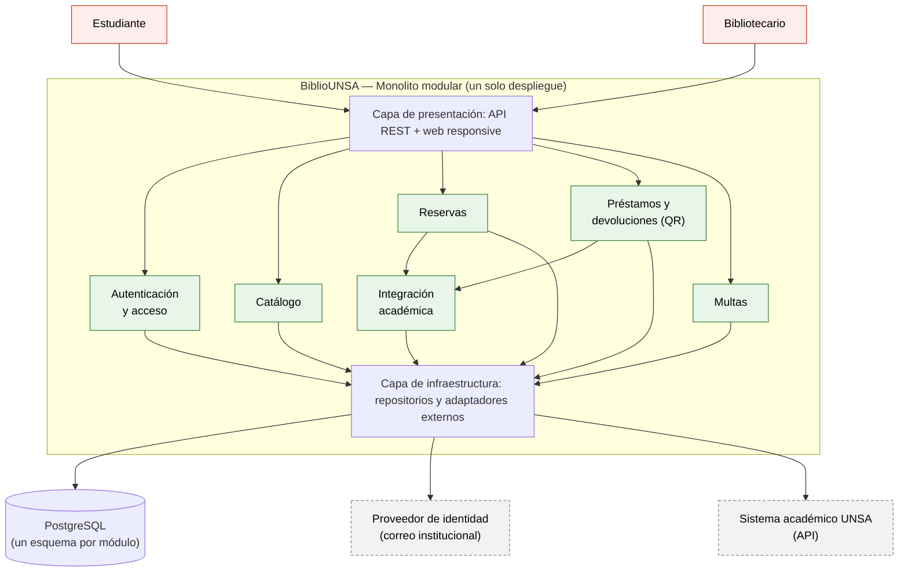
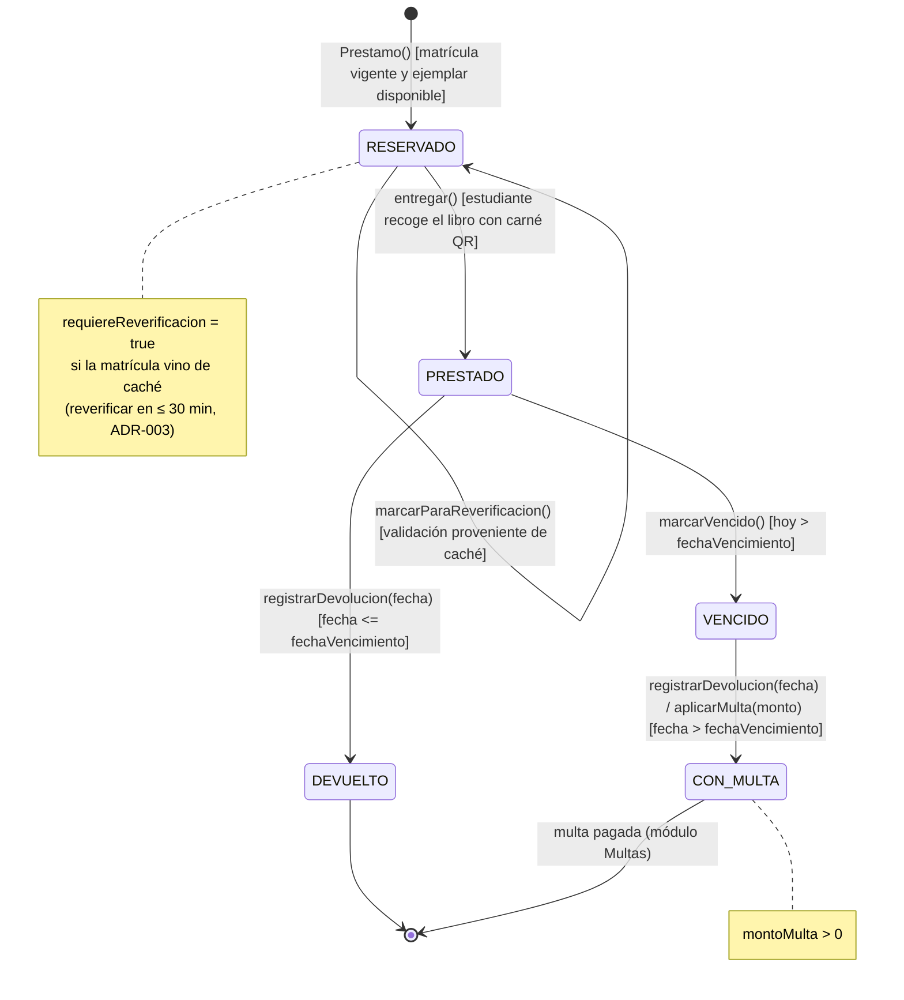
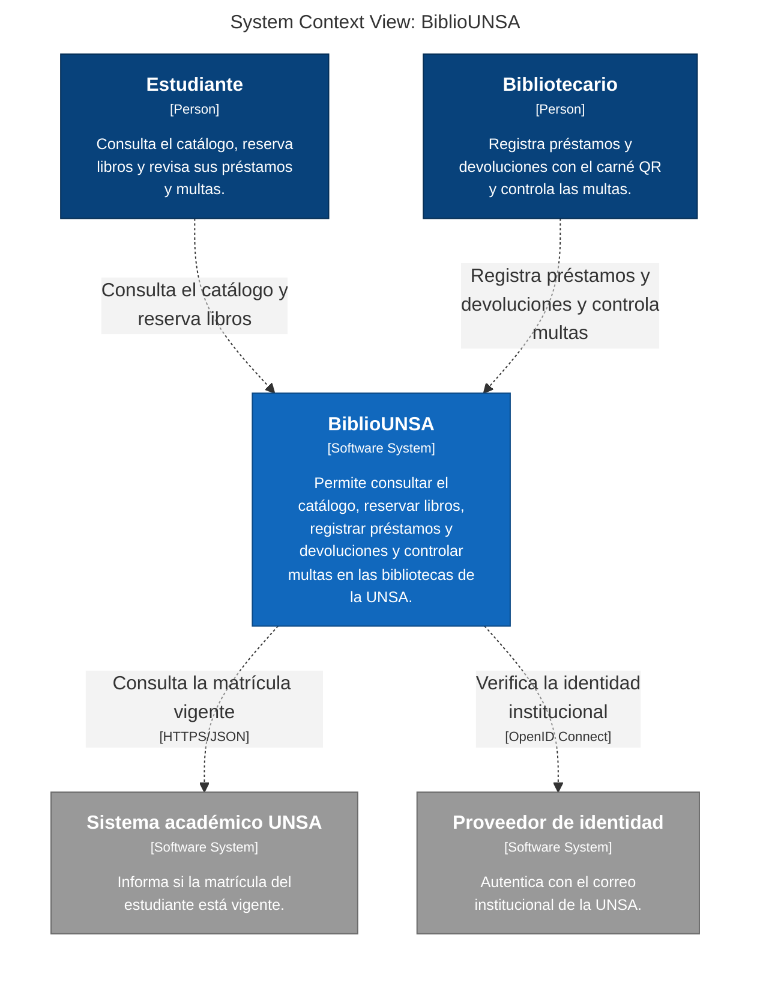
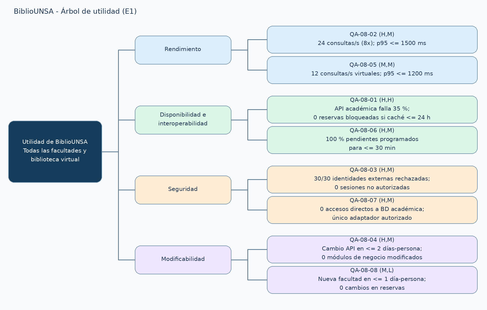

# BiblioUNSA — Laboratorio 04: Fundamentos de arquitectura de software
Construcción de Software · EPIS-UNSA · 2026-B · Grupo 04
 
## Integrantes
| Nombre | Rol en el laboratorio |
|--------|-----------------------|
| Valerio | Analista de drivers y responsable de la matriz de decisión |
| Mijael | Diagramador y redactor de ADR |
| Mauricio | Verificador de IA y responsable de documentación adicional |
 
## Caso
BiblioUNSA es una plataforma para el préstamo y la reserva de libros de las bibliotecas de la UNSA. Los estudiantes consultan el catálogo y reservan libros, y los bibliotecarios registran préstamos y devoluciones con el carné QR y controlan las multas. El sistema valida la matrícula vigente consultando al sistema académico solo mediante su API, sin acceder a su base de datos. El atributo de calidad crítico es la **seguridad e interoperabilidad**: únicamente debe entrar personal y estudiantes de la UNSA con su correo institucional.
 
## Arquitectura elegida
Monolito modular: un solo despliegue, con módulos separados y la integración académica aislada en un adaptador.



## Decisiones arquitectónicas
- [ADR-001: Estilo arquitectónico](docs/architecture/adr/001-estilo-arquitectonico.md)
- [ADR-002: Autenticación](docs/architecture/adr/002-autenticacion.md)
- [ADR-003: Integración Académica](docs/architecture/adr/003-integracion-academica.md)
- [ADR-005: Patrones de diseño (Lab 07)](docs/architecture/adr/005-patrones-de-diseno.md)

## Reflexión sobre el uso de la IA (5–8 líneas)
La IA (Claude) nos ayudó a generar alternativas de estilo, redactar el borrador de los drivers y escenarios de calidad, puntuar la matriz de decisión y escribir el código Mermaid del diagrama. También cometió errores: recomendó microservicios, que no encajan con el plazo de 1 mes, los 3 developers ni el presupuesto de un VPS, y afirmó sin evidencia que el sistema académico de la UNSA tiene una API REST pública y documentada. Además, propuso un proveedor de identidad OAuth/OIDC que aún no está confirmado. Aprendimos a contrastar cada recomendación con nuestras restricciones, a recalcular a mano los totales de la matriz, a validar el diagrama en mermaid.live y GitHub, y a confirmar con la oficina responsable cualquier afirmación sobre sistemas reales. Por eso aislamos la integración en un adaptador con caché. La IA propone, pero el equipo decide y verifica; todo quedó registrado en la [bitácora](docs/architecture/bitacora-ia.md).

## Diseño UML (Lab 05)
Diseño detallado de la historia **HU-03: reservar un libro validando la matrícula vigente**, escrito como código (PlantUML y Mermaid), coherente con el ADR-001 y el ADR-003. La IA propuso los diagramas y el equipo los revisó con las reglas de consistencia C1–C5; todo quedó en la [bitácora de IA del Lab 05](docs/design/bitacora-ia.md).

### Máquina de estados del préstamo
Cada transición se nombra con una operación de la clase `Prestamo` (regla C2) y los estados coinciden con la enumeración `EstadoPrestamo`.



### Diagramas y documentos
| Entregable | Fuente | Imagen |
|------------|--------|--------|
| E1 Historia de usuario | [historia.md](docs/design/historia.md) | — |
| E1 Diagrama de clases | [clases-lab05-original.puml](docs/design/clases-lab05-original.puml) | [PNG](docs/design/img/diagrama_clases.png) |
| E2 Diagrama de secuencia | [secuencia-reservar-libro.puml](docs/design/secuencia-reservar-libro.puml) | [PNG](docs/design/img/secuencia-reservar-libro.png) |
| E3 Máquina de estados | [estados-prestamo.mmd](docs/design/estados-prestamo.mmd) | [PNG](docs/design/img/estados-prestamo.png) |
| E4 Diagrama de actividades | [actividades-devolucion-multa.puml](docs/design/actividades-devolucion-multa.puml) | [PNG](docs/design/img/actividades-devolucion-multa.png) |
| E5 Diagrama de paquetes | [paquetes.puml](docs/design/paquetes.puml) | [PNG](docs/design/img/paquetes.png) |
| E6 Round-trip | [round-trip.md](docs/design/round-trip.md) · [dominio.py](src/reservas/dominio.py) | [PNG](docs/design/img/classes_reservas.png) |
| E7 Consistencia C1–C5 | [consistencia.md](docs/design/consistencia.md) | — |
| E7 Bitácora de IA (Lab 05) | [bitacora-ia.md](docs/design/bitacora-ia.md) | — |

## Arquitectura C4 (Lab 06)
Modelo C4 de BiblioUNSA escrito como código en **un solo archivo** ([`workspace.dsl`](docs/architecture/c4/workspace.dsl), Structurizr DSL) del que se derivan las cinco vistas. Es coherente con el [ADR-001](docs/architecture/adr/001-estilo-arquitectonico.md) (contenedores y módulos), el [ADR-002](docs/architecture/adr/002-autenticacion.md), el [ADR-003](docs/architecture/adr/003-integracion-academica.md) y el [diagrama de paquetes](docs/design/paquetes.puml) del Lab 05 (las dependencias entre componentes coinciden exactamente y no hay ciclos). El nivel 4 (código) se apoya en el [diagrama de clases](docs/design/clases.puml), actualizado con los patrones del Laboratorio 07; conservamos [el original del Lab 05](docs/design/clases-lab05-original.puml).

### Contexto (nivel 1, exportado a Mermaid desde [`export/`](docs/architecture/c4/export/structurizr-Contexto.mmd))



### Vistas
| Vista | Imagen (C4-PlantUML) | Fuente exportada |
|-------|----------------------|------------------|
| Nivel 1 · Contexto | [PNG](docs/architecture/c4/img/contexto.png) | [puml](docs/architecture/c4/export/structurizr-Contexto.puml) · [mmd](docs/architecture/c4/export/structurizr-Contexto.mmd) |
| Nivel 2 · Contenedores | [PNG](docs/architecture/c4/img/contenedores.png) | [puml](docs/architecture/c4/export/structurizr-Contenedores.puml) · [mmd](docs/architecture/c4/export/structurizr-Contenedores.mmd) |
| Nivel 3 · Componentes de la API | [PNG](docs/architecture/c4/img/componentes.png) | [puml](docs/architecture/c4/export/structurizr-Componentes.puml) · [mmd](docs/architecture/c4/export/structurizr-Componentes.mmd) |
| Dinámica · Reservar un libro (HU-03) | [PNG](docs/architecture/c4/img/dynamicReservarLibro.png) | [puml](docs/architecture/c4/export/structurizr-ReservarLibro.puml) · [mmd](docs/architecture/c4/export/structurizr-ReservarLibro.mmd) |
| Despliegue · Producción | [PNG](docs/architecture/c4/img/despliegue.png) | [puml](docs/architecture/c4/export/structurizr-Despliegue.puml) · [mmd](docs/architecture/c4/export/structurizr-Despliegue.mmd) |

### Documentos del Lab 06
| Entregable | Archivo |
|------------|---------|
| E1 Inventario de elementos | [inventario.md](docs/architecture/c4/inventario.md) |
| E1–E5 Modelo único | [workspace.dsl](docs/architecture/c4/workspace.dsl) |
| E6 Contexto escrito a mano | [contexto-manual.puml](docs/architecture/c4/contexto-manual.puml) · [PNG](docs/architecture/c4/img/contexto-manual.png) |
| E4 y E6 Comparaciones | [comparacion.md](docs/architecture/c4/comparacion.md) |
| E7 Lista de revisión y hallazgos de la IA | [revision-c4.md](docs/architecture/c4/revision-c4.md) |
| E7 Explicación para público no técnico | [explicacion.md](docs/architecture/c4/explicacion.md) |
| E7 Bitácora de IA | [bitacora-ia.md](docs/architecture/c4/bitacora-ia.md) |
| Cuestionario | [cuestionario.md](docs/architecture/c4/cuestionario.md) |

## Patrones de diseño (Lab 07)

En el Laboratorio 07 refactorizamos el flujo **HU-03: reservar un libro
validando la matrícula vigente** de BiblioUNSA. Primero conservamos una versión
directa en `src/reservas/antes/servicio.py` y preparamos pruebas de
caracterización. Después separamos las variaciones de integración, las
transiciones del préstamo y las notificaciones. También añadimos una función
de **recomendación de libros mediante un LLM simulado**, que solo puede
devolver ISBN pertenecientes a nuestro catálogo.

### Olores encontrados, patrones y pruebas

| Olor o necesidad detectada | Patrón aplicado | Evidencia de prueba |
|---|---|---|
| `if/elif` para elegir el contrato de la API académica | **Strategy** (`ValidadorMatricula`) | `test_open_closed_nuevo_proveedor_sin_modificar_servicio` |
| El servicio interpreta diccionarios y tuplas de sistemas diferentes | **Adapter** (`AdaptadorMatriculaJSON`, `AdaptadorMatriculaCodigos`) | `test_adapter_json_devuelve_el_contrato_comun` |
| Crear un validador según proveedor sin editar la reserva | **Simple Factory** (`FabricaValidadores`) | `test_factory_crea_la_estrategia_registrada_y_rechaza_desconocida` |
| Transiciones del préstamo condicionadas por su estado | **State** (`Reservado`, `Prestado`, `Vencido`, `Devuelto`, `ConMulta`) | `test_transicion_invalida_no_permite_devolver_reservado` |
| El servicio escribe directamente su historial y avisos | **Observer** (`PublicadorEventos` y dos suscriptores) | `test_observer_publica_un_evento_a_dos_suscriptores` |
| Los reintentos de la API estaban mezclados con la reserva | **Decorator** (`ConReintentos`) | `test_decorator_reintenta_dos_timeouts_y_luego_devuelve_respuesta` |
| Necesitamos cambiar el proveedor de recomendaciones sin tocar el caso de uso | **Strategy + Adapter** de IA (`ProveedorLLM`, `AdaptadorMotorSimulado`) | `test_proveedor_llm_puede_sustituirse_sin_modificar_recomendador` |
| Se repetían las consultas de IA para prompts iguales | **Decorator** (`ConCacheLLM`) | `test_decorator_cache_evita_otra_llamada_al_mismo_prompt` |
| Una IA puede inventar ISBN o devolver JSON incorrecto | **Chain of Responsibility** (`GuardrailFormato` → `GuardrailCatalogo`) | `test_guardrails_validan_incluso_respuestas_procedentes_de_cache` |

La Factory empleada es un registro sencillo, **no Abstract Factory**. Los
patrones GoF distintos aplicados son Strategy, Adapter, State, Observer,
Decorator y Chain of Responsibility.

### Métricas antes y después

Las mediciones se hicieron con Radon 6.0.1. **SLOC** cuenta líneas de código
fuente, sin comentarios ni líneas vacías. Para el total se compara el código
de reservas y dominio, sin mezclar los simuladores ni la nueva función de IA.

| Métrica | Antes (E1) | Después (E5) |
|---|---:|---:|
| Complejidad de `ServicioReservas.reservar_libro` | **15 (C)** | **9 (B)** |
| Complejidad de `ServicioReservas.__init__` | 3 (A) | 6 (B) |
| Promedio del archivo del servicio | **5,17 (B)** | **5,20 (B)** |
| Promedio de bloques de reservas + dominio | 1,95 (A) | 1,83 (A) |
| SLOC del servicio principal | 104 | 101 |
| SLOC de reservas + dominio | **222** | **378** |
| Archivos del alcance reservas + dominio | 2 | 6 |

El método principal quedó menos complejo (**15 → 9**), pero el refactor
también aumentó el código del conjunto en **156 SLOC (70,3 %)**. Aceptamos
ese costo porque se pueden ampliar proveedores, avisos y reglas de estados
sin concentrar toda la lógica en un único método. El promedio del archivo
del servicio prácticamente **no mejoró**, y lo registramos como parte del
análisis, no como un resultado favorable inventado.

La versión anterior habría bastado con un proveedor académico fijo, sin
suscriptores adicionales y sin cambios previstos en el ciclo de vida del
préstamo. No se aplicaron **Abstract Factory**, **Singleton**, un Proxy
académico adicional ni un segundo LLM como juez, porque no justifican su
costo para este MVP. Los guardrails son reglas deterministas, incluso para
las respuestas de IA recuperadas de caché.

### Ejecutar y comprobar

Con Python 3.10 o superior, desde la raíz del proyecto:

```bash
python -m pip install -r requirements-lab07.txt
python -m pytest -q tests/
python -m radon cc -s -a src/reservas/antes/servicio.py
python -m radon cc -s -a src/reservas/servicio.py
```

## Diseño de la arquitectura (Lab 08)

**Caso de crecimiento:** todas las facultades y biblioteca virtual, con indisponibilidad de la API académica durante matrícula. Se mantiene el monolito modular (ADR-001), el VPS y la integración solo mediante API.



El [árbol de utilidad](docs/architecture/utilidad/escenarios.md) cubre disponibilidad, rendimiento, seguridad y modificabilidad con ocho escenarios medibles.

| Iteración | Escenario | Táctica escogida | Evidencia (simulación) | ¿Cumple? |
|---|---|---|---|---|
| [ADD 1](docs/architecture/add/iteracion-1.md) | QA-08-01 | Caché académica reciente y outbox durable | 274 bloqueos con caché a 0; 53 sin caché siguen bloqueados | Sí, para validaciones recientes |
| [ADD 2](docs/architecture/add/iteracion-2.md) | QA-08-02 | Optimizar consultas e índices PostgreSQL | p95 76155,4 a 253,5 ms a 24 req/s (modelo) | Sí, en simulación |
| [ADD 3](docs/architecture/add/iteracion-3.md) | QA-08-03/07 | OIDC verificado + adaptador académico aislado | 30/30 intentos externos rechazados (casos sintéticos) | Sí, en prototipo |

Decisiones y vistas:

- [ADR-006: continuidad de matrícula](docs/architecture/adr/006-resiliencia-matricula.md).
- [ADR-007: índices del catálogo](docs/architecture/adr/007-indices-catalogo.md).
- [ADR-008: seguridad e aislamiento](docs/architecture/adr/008-identidad-y-aislamiento.md).
- [C4 actualizado](docs/architecture/c4/workspace.dsl) y [vista resumida de contenedores](docs/architecture/c4/contenedores-lab08.mmd).
- [ATAM-lite y matriz de riesgos](docs/architecture/atam-lite.md), [bitácora de IA](docs/architecture/bitacora-ia-lab08.md) y [fitness functions](docs/architecture/fitness-verificacion.md).

