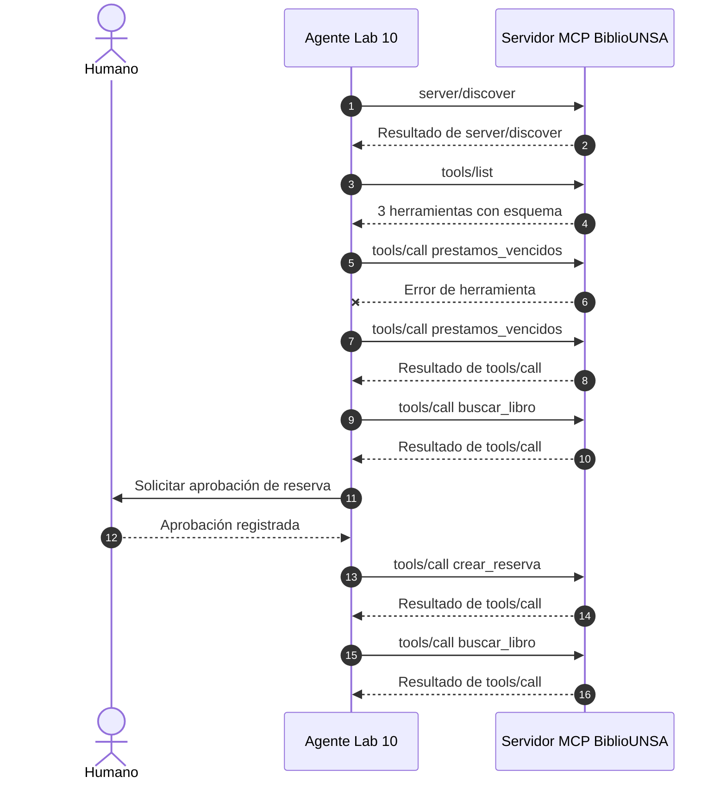

# E6. Análisis del protocolo y costo de contexto

Se analizaron los mensajes JSON-RPC capturados por el espía stdio. La ejecución original de E4 se conserva sin cambios. La optimización acorta las descripciones de las tres herramientas sin cambiar sus nombres, parámetros, anotaciones ni lógica de dominio.

- Traza original: `agentes/mcp/trazas/e4`.
- Traza optimizada: `agentes/mcp/trazas/e6-optimizado`.

## 1. Diagrama de secuencia de E4

El diagrama se genera a partir de peticiones y respuestas emparejadas por id. La aprobación se incorpora solo si consta en el registro de aprobaciones de la ejecución.

Los diagramas generados para ambas ejecuciones se encuentran en [trazas/e6/mcp_trafico.mmd](trazas/e6/mcp_trafico.mmd) y [trazas/e6/mcp_trafico-optimizado.mmd](trazas/e6/mcp_trafico-optimizado.mmd).

## 2. Métricas de la comunicación

| Métrica | Original | Optimizado |
|---|---:|---:|
| Mensajes JSON-RPC | 14 | 14 |
| Bytes JSON UTF-8 normalizados | 12536 | 12393 |
| Peticiones sin respuesta registrada | 0 | 0 |
| Errores de herramienta | 1 | 1 |
| Errores de protocolo | 0 | 0 |

Los bytes se calculan sobre los objetos JSON serializados de forma compacta en UTF-8, sin separadores de línea; no equivalen necesariamente a los bytes originales del transporte, que el espía de E4 no guardó. La latencia mide desde el registro de la petición hasta el registro de la respuesta; no incluye el tiempo humano ni el del modelo entre llamadas.

| Método | N original | Media original (ms) | Mín–máx original (ms) | N optimizado | Media optimizada (ms) | Mín–máx optimizado (ms) |
|---|---:|---:|---:|---:|---:|---:|
| `server/discover` | 1 | 1140.158 | 1140.158–1140.158 | 1 | 1180.968 | 1180.968–1180.968 |
| `tools/call` | 5 | 5.354 | 1.836–16.504 | 5 | 6.303 | 1.83–16.482 |
| `tools/list` | 1 | 1.444 | 1.444–1.444 | 1 | 1.294 | 1.294–1.294 |

Ambas ejecuciones registraron siete peticiones y siete respuestas, sin errores de protocolo ni peticiones pendientes. El único error de herramienta correspondió a la fecha ingresada intencionalmente en un formato inválido. El volumen JSON normalizado disminuyó en 143 bytes. El descubrimiento inicial fue la operación más lenta en ambos casos; las llamadas a herramientas tuvieron una media de 5.354 ms y 6.303 ms, respectivamente. Por lo tanto, esta comparación no demuestra una mejora de velocidad.

## 3. Costo de contexto del catálogo

Se emplea la misma estimación de un token por cada cuatro caracteres (redondeada hacia arriba) en las dos ejecuciones. No es el conteo exacto de ningún modelo. Se mide tanto la lista completa de herramientas MCP como el catálogo de descripciones y esquemas de entrada que el adaptador del agente incorpora al contexto; no se incluye el historial ni las instrucciones generales.

| Catálogo | Tokens estimados antes | Tokens estimados después | Reducción |
|---|---:|---:|---:|
| MCP completo | 1086 | 1051 | 3.22 % |
| Catálogo del agente | 432 | 396 | 8.33 % |

| Herramienta | Tokens estimados antes | Tokens estimados después | Reducción |
|---|---:|---:|---:|
| `buscar_libro` | 399 | 392 | 1.75 % |
| `prestamos_vencidos` | 365 | 354 | 3.01 % |
| `crear_reserva` | 322 | 304 | 5.59 % |

La reducción fue de 35 tokens estimados en el catálogo MCP completo y de 36 en el catálogo utilizado por el agente. Este último obtuvo un ahorro del 8.33 %, mientras que `crear_reserva` presentó la mayor reducción proporcional entre las tres herramientas. Se conservaron los datos necesarios para seleccionar cada operación y utilizar sus argumentos correctamente.

## 4. Selección de herramientas después de optimizar

| Verificación | Original | Optimizado |
|---|---|---|
| Corrección del formato de fecha | Sí | Sí |
| Reserva única con aprobación humana | Sí | Sí |
| Ejemplar disponible antes de reservar | Sí | Sí |
| Ejemplar no disponible después de reservar | Sí | Sí |
| Dos lecturas exitosas | Sí | Sí |

Secuencia original: `prestamos_vencidos` (error) → `prestamos_vencidos` → `buscar_libro` → `crear_reserva` → `buscar_libro`.

Secuencia optimizada: `prestamos_vencidos` (error) → `prestamos_vencidos` → `buscar_libro` → `crear_reserva` → `buscar_libro`.

Contratos publicados (sin descripciones) idénticos: **Sí**.

En las dos ejecuciones se identificaron dos préstamos vencidos, se encontró el ejemplar LAB11-101 y se creó una reserva ficticia con aprobación humana. La búsqueda posterior confirmó que el ejemplar ya no estaba disponible. La comparación de los contratos publicados también indicó que los esquemas y las demás propiedades permanecieron iguales al excluir las descripciones.

## 5. Conclusión

La optimización permitió reducir el costo estimado del catálogo sin alterar el resultado del escenario evaluado. El agente mantuvo la capacidad de corregir entradas inválidas, seleccionar las herramientas apropiadas y solicitar autorización antes de crear una reserva. El ahorro del 8.33 % en el catálogo del agente muestra que una descripción más concisa puede aprovechar mejor el contexto sin eliminar información necesaria. Estos resultados corresponden a dos ejecuciones del mismo caso y no garantizan el mismo comportamiento en otras consultas o modelos. Tampoco permiten concluir que la optimización reduzca las latencias.

Los archivos [metricas-original.json](trazas/e6/metricas-original.json) y [metricas-optimizado.json](trazas/e6/metricas-optimizado.json) conservan los resultados del análisis.
