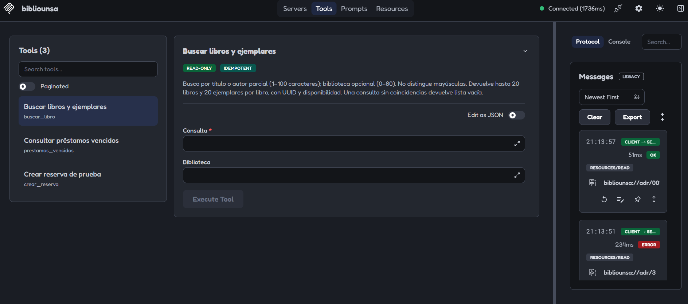
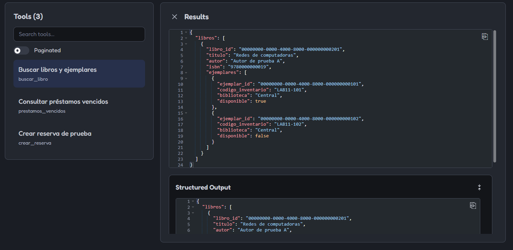
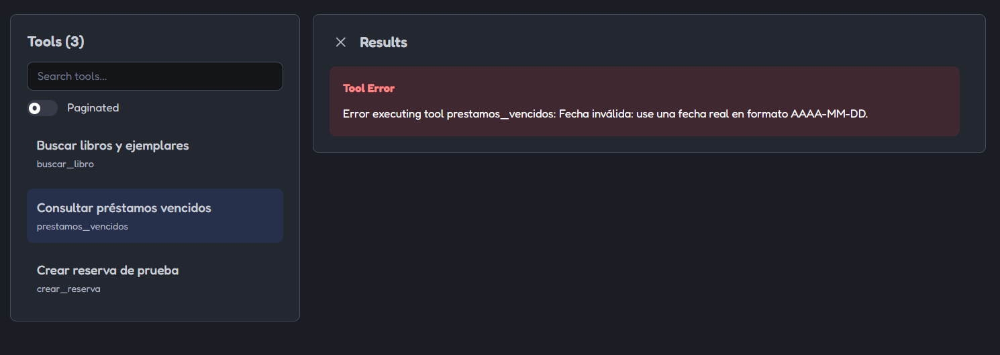

# E3. Verificación con MCP Inspector — BiblioUNSA

## 1. Entorno y ejecución

Para verificar el funcionamiento del servidor MCP de BiblioUNSA, se utilizó MCP Inspector, una herramienta que permite consultar las capacidades del servidor y ejecutar sus operaciones sin necesidad de un modelo de lenguaje. Las pruebas se realizaron con los datos ficticios preparados en el Laboratorio 11.

Desde la raíz del repositorio se inició Inspector mediante el siguiente comando:

```powershell
npx @modelcontextprotocol/inspector python agentes/mcp/servidor_mcp/bibliounsa_mcp.py
```

Se estableció la conexión con el servidor mediante el transporte STDIO y se realizaron las verificaciones que se presentan a continuación.

## 2. Catálogo de herramientas



**Figura 1.** Catálogo de herramientas del servidor BiblioUNSA en MCP Inspector.

En la Figura 1 se observa que Inspector se conectó correctamente al servidor y descubrió las tres herramientas definidas en E1: `buscar_libro`, `prestamos_vencidos` y `crear_reserva`. Al seleccionar la herramienta de búsqueda, se muestra su descripción, el campo obligatorio `consulta` y el campo opcional `biblioteca`. También aparecen las anotaciones `READ-ONLY` e `IDEMPOTENT`, que indican que esta operación es de lectura y que repetirla no produce efectos adicionales sobre los datos.

Esta verificación permite comprobar que el cliente puede conocer las herramientas y sus parámetros sin acceder directamente al código fuente del servidor.

## 3. Llamada correcta a una herramienta



**Figura 2.** Resultado de la ejecución de la herramienta `buscar_libro`.

Se realizó una búsqueda de libros relacionados con redes en la Biblioteca Central. Como se aprecia en la Figura 2, el servidor devolvió el libro *Redes de computadoras*, junto con su identificador, título, autor, ISBN y los datos de sus dos ejemplares:

| Código de inventario | Biblioteca | Disponibilidad |
| --- | --- | --- |
| LAB11-101 | Central | Disponible (`true`) |
| LAB11-102 | Central | No disponible (`false`) |

Además, Inspector muestra la sección `Structured Output`, donde el resultado se presenta como datos estructurados en formato JSON. Esto facilita que otros clientes o agentes puedan procesar la información directamente, sin tener que interpretar una respuesta en lenguaje natural.

## 4. Llamada con un argumento inválido



**Figura 3.** Error de validación al ejecutar `prestamos_vencidos`.

Para comprobar el manejo de entradas inválidas, se ejecutó la herramienta `prestamos_vencidos` con una fecha en un formato no admitido. El servidor rechazó la solicitud e Inspector mostró el siguiente mensaje:

```text
Error executing tool prestamos_vencidos: Fecha inválida: use una fecha real en formato AAAA-MM-DD.
```

El resultado demuestra que el servidor valida los datos antes de realizar la consulta y devuelve un error comprensible. En lugar de presentar un fallo genérico, informa al cliente sobre el formato que debe utilizar para corregir la solicitud.

## 5. Verificaciones complementarias y pruebas de contrato

En el historial de protocolo de la Figura 1 se observan dos operaciones `resources/read`, una exitosa y otra con error. Sin embargo, las URI se muestran recortadas, por lo que la captura no permite confirmar los argumentos completos ni la causa del rechazo. La comprobación específica de la protección frente a rutas arbitrarias, las anotaciones de las demás herramientas y los prompts debe respaldarse con las pruebas de contrato o con evidencias adicionales.

Las pruebas automatizadas del servidor se ejecutan con:

```powershell
python -m pytest -q agentes/mcp/pruebas/test_servidor_mcp.py
```

**Resultado de pytest:** no consignado en las evidencias adjuntas a este documento.

## 6. Conclusión

Mediante MCP Inspector se comprobó que el servidor BiblioUNSA permite descubrir las tres herramientas de su catálogo, ejecutar una consulta de libros con salida estructurada y rechazar una entrada inválida mediante un mensaje de error útil. Estas verificaciones constituyen las tres evidencias visuales solicitadas en E3 y complementan las pruebas automatizadas de contrato del servidor.
